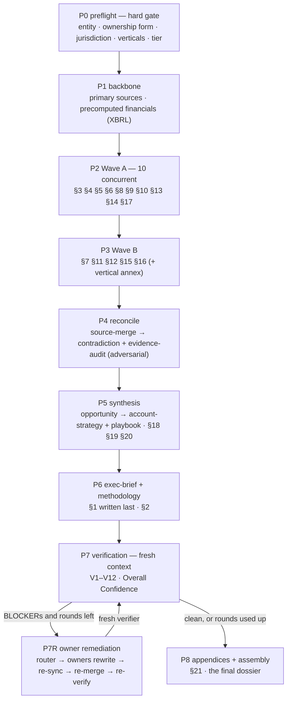
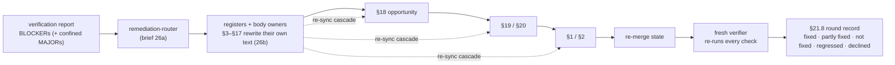

# Architecture

This page is the overview. The design decisions behind the dossier, and why each one exists, are
in [harness/ARCHITECTURE.md](../harness/ARCHITECTURE.md); the harness layout and workflow
arguments are in [harness/HARNESS_README.md](../harness/HARNESS_README.md).

## Layers

```mermaid
flowchart TB
  subgraph Surfaces
    CC["Claude Code plugin<br/>/vantage:generate · /vantage:export"]
    TUI["vantage-tui (Ink)"]
    CLI["vantage CLI"]
    HTTP["vantage serve<br/>GET /healthz · POST /run"]
  end
  TUI -- "spawns vantage … --json" --> CLI
  CLI --> ENG
  HTTP --> ENG
  CC -- "Workflow tool, natively" --> H
  subgraph ENG["Engine (src/vantage)"]
    BE["engine/: six backends"] --> PIPE["pipeline/ + agents/: stage DAG, generic executor"]
    PIPE --> REN["render/: merge, assembly"]
    EXP["export/: plans → pptx · docx · pdf · html"]
  end
  H["harness/: blueprint, briefs, contracts,<br/>state schema, workflows (read at runtime)"]
  BE --> H
  PIPE --> H
  EXP --> HX["harness/export/"]
```



- **The harness is the product.** `harness/` holds the 22-section blueprint, one Markdown brief per
  agent, the section contracts, evidence policy, verification protocol, scoring rubrics,
  jurisdiction adapters, vertical modules, the state schema (3.0) and the Claude Code workflow. It
  is read at runtime, so you can change a brief or a rubric without changing code.
- **One generic executor** runs every LLM agent from its brief. `source-merge`, `assembly` and the
  XBRL precompute are deterministic Python in the programmatic backends, because collation and
  arithmetic must be exact.
- **Backends** reuse the identical stage graph through an injectable per-agent runner and stage
  lifecycle ([Backends](backends.md)).
- **Surfaces** never re-implement the engine. The TUI drives the CLI's `--json` contracts; the
  plugin skills call the CLI or run the bundled workflows.

## The pipeline

29 agents across 12 steps, up to ten concurrent:



`EXECUTIVE` runs six Wave A agents, skips Wave B and produces §0–§2 plus the §1 synthesis.
`STANDARD` and `FULL_ANNEX` run the full roster.

Properties that do most of the work:

- **§1 is written last and placed first.** An executive summary written first invents conclusions
  the body then has to justify.
- **The adversarial audit runs before §18.** A refuted claim caught at P4 costs one downgrade;
  caught at verification it costs a rebuild of §18–§20. The refuted list is binding.
- **§3–§17 are vendor-neutral**, checked at BLOCKER severity, so the dossier reads as research,
  not pre-sales material. §15.6 is the single gated exception.
- **Gated content.** Win probability, account revenue, relationship strength and stakeholder
  access cannot come from public evidence. Without the §21.10 Account-Team Input Sheet they render
  `[INTERNAL REQUIRED]`; without the Capability Pack every capability claim renders
  `[INTERNAL: validate with practice]`. `vantage run --input-sheet ATTACHED --capability-pack
  ATTACHED` is how the account team unlocks them.
- **Parallelism has its own checks.** Pre-allocated ID blocks prevent collisions; `source-merge`
  catches duplicate sources and false triangulation; a missing agent is named, never absorbed
  (V10).

## P7R: owner remediation

Verification may downgrade a claim or add a label, but it may not rewrite another agent's
analysis: a verifier that rewrites is no longer independent. Before P7R that rule left prose
defects *annotated* rather than fixed. P7R closes the loop without breaking the rule.



1. **Route.** `remediation-router` turns the findings into work orders for the agents that own the
   defective text, one order per hop of a dependency chain. Findings that need a document nobody
   retrieved are *unroutable*: they stay disclosed, with the topic named for an extended-budget
   re-run. P7R is for rewriting, not research.
2. **Rewrite in dependency order.** Each owner revises only its own section and state fragment,
   tier by tier: registers → body → §18 → §19/§20 → §1/§2. A fix to §18 made before its §8 origin
   is fixed would only restate the defect.
3. **Synthesis re-sync cascade.** Once a register or body owner rewrites, every synthesis owner
   downstream of it (§18–§20, §1) is re-dispatched to re-sync, even when no finding names its text.
   Without this, early runs fixed §4 and §8 while §18, §19 and §1 kept restating the pre-fix
   values, which the re-verifier then raised as new BLOCKERs.
4. **Re-verify from scratch.** A fresh verifier re-runs every check, because a rewrite can
   introduce a defect as easily as remove one. §21.8 records each round.

Rounds: `vantage run --remediation-rounds 0|1|2` (default 1; `0` disables). The workflow backend
implements P7R; the programmatic backends do not yet. Run artifacts: `qa/remediation-orders.r<n>.json`
and `qa/verification-report.r<n>.*` (the report as it stood before round n+1).

## Reading a dossier

Three things say how far to trust a dossier, all in the title block or §21:

1. **Overall Confidence** — `Strong` ≥80 · `Adequate` 65–79 · `Thin` 50–64 · `Insufficient` <50,
   with its EQI and the verification result (`PASS`, `PASS WITH DISCLOSURES` or `FAIL`).
   **Insufficient means do not present it.**
2. **§21.12 Source-Completeness Scorecard** — which topics stopped on *budget* rather than on
   diminishing returns. Those are worth re-running with a larger budget; the rest genuinely found
   nothing.
3. **§2.5 Limitations and §21.11** — every autonomous assumption, high-materiality gap and open
   contradiction.

A run that renders 60% of its sections honestly is worth more than one that renders 100% with a
quarter invented.

## Run directory

```text
<output_dir>/<slug>/
  <slug>-vantage.md                  the dossier
  sections/                          one file per owning agent, in blueprint order
  state/state.json                   merged schema-3.0 state
  state/precomputed-financials.json  the numeric source of truth for §6
  state/fragments/<agent>.json       per-agent contributions before merge
  qa/evidence-audit.json             adversarial verdicts; the refuted list is binding
  qa/verification-report.md|.json    V1–V12 outcomes, Overall Confidence, disclosures
  qa/remediation-orders.r<n>.json    P7R work orders
  qa/source-rewrite-map.json         retired → kept source IDs after dedup
  run.jsonl                          structured event stream (what the TUI shows)
  exports/                           vantage export output
```

## Export

The export pipeline (ingest → plan → assets → charts → render → manifest) is described in
[Export](export.md#pipeline) and [harness/export/ARCHITECTURE.md](../harness/export/ARCHITECTURE.md).

## Lineage

The harness implements the Vantage Prompt Package v3.0.0, kept for reference in
[docs/prompts/vantage-v1/](prompts/vantage-v1/vantage-20260829.md) together with its
[tooling catalog](prompts/vantage-v1/vantage-tools-20260829.md).
