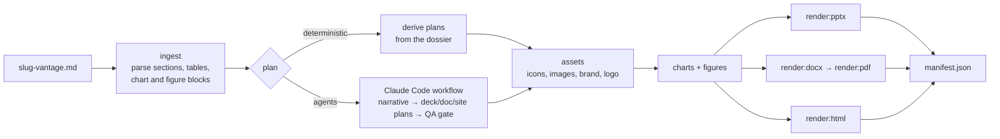

# Export

`vantage export` turns a finished dossier into collateral: a PowerPoint deck, a Word whitepaper, a
PDF of that whitepaper, and one self-contained HTML file (a microsite or an HTML deck). It formats
an existing dossier only. It does no research and adds no facts.

```bash
uv sync --extra export                       # once: python-pptx, python-docx, matplotlib, plotly …
uv run vantage export example-2026-10        # a run slug, a run directory, or a *-vantage.md file
```

All options: [CLI reference](reference/cli.md#vantage-export). Defaults come from the `export`
section of the [configuration](configuration.md#export).

## What you get

```text
<run dir>/exports/                 (or --out DIR, or export.out_dir)
  <slug>-deck.pptx                 PowerPoint deck
  <slug>-whitepaper.docx           Word whitepaper
  <slug>-whitepaper.pdf            PDF of the whitepaper (needs LibreOffice)
  <slug>-microsite.html            or <slug>-deck.html with --site-mode deck; one offline file
  manifest.json                    artifacts, sizes, slide/page counts, plan sources, warnings
  plan/                            deck.json, doc.json, site.json (+ story.md, qa.json when agents authored them)
  .assets/                         cached icons, images, brand assets, charts, diagrams
```

| Option | Values | Default |
|---|---|---|
| `--format`, `-f` | `pptx` `docx` `pdf` `html`, repeatable. `pdf` implies `docx` | `export.formats` (all four) |
| `--depth` | `exec` ≈ 18 slides / ~40 pages · `standard` ≈ 31 slides / ~125 pages · `full` every section and appendix | `standard` |
| `--site-mode` | `microsite` (navigable single page) · `deck` (slides in the browser) | `microsite` |
| `--authoring` | `deterministic` · `agents` | `deterministic` |
| `--out`, `-o` | output directory | `<run dir>/exports` |
| `--classification` | marking text | `Confidential` |
| `--brand` | a domain, themed through `get-brand` | none: the neutral Vantage theme |
| `--client-logo` / `--no-client-logo` | the client's logo on the cover | on |
| `--open` | open the output folder when done | off |
| `--json` | stream events, then `{"result": …}` | off |

```bash
uv run vantage export example-2026-10 -f pptx --depth exec                 # the executive deck only
uv run vantage export example-2026-10 -f html --site-mode deck --open      # an HTML deck
uv run vantage export example-2026-10 -f pdf --classification "Internal"   # whitepaper + PDF
uv run vantage export ~/.cache/vantage/run/example-2026-10 --brand example.org
```

## Pipeline



The one rule: **agents write plans, code writes files.** A plan is a small JSON document validated
against the models in `src/vantage/export/models.py`; the renderers own every pixel. The same plan
always renders the same output, a person can read and edit it, and a plan has no vocabulary for
dropping the classification marking, the verification result or the scoring disclaimer. The
design is described in [harness/export/ARCHITECTURE.md](../harness/export/ARCHITECTURE.md).

### Authoring modes

- **`deterministic`** (default) maps the dossier's sections to plans directly. Fast, offline, no
  model involved.
- **`agents`** runs the export workflow (`harness/export/workflows/vantage-export.workflow.mjs`)
  through the Claude Code CLI on your subscription: one agent decides the story, three author the
  deck, document and site plans concurrently, and an adversarial QA agent checks every number
  against the dossier. Code then renders. It needs `claude` on PATH (or `CLAUDE_CLI`); without it
  the export falls back to derived plans and warns.

### Editing a plan and re-rendering

The renderer prefers a plan on disk in `<out>/plan/`. Edit `deck.json`, `doc.json` or `site.json`
and run the same `vantage export` command again; `manifest.json` then records that plan as
`authored`. The other states are `scaffold` (generated and unedited) and `derived` (no plan on
disk, or one that failed validation; the warning says why). A malformed plan only degrades its
own collateral.

To write editable scaffolds without rendering anything:

```bash
uv run python -m vantage.export plan <dossier> --out <dir>
```

A plan on disk wins over `--depth` and `--site-mode`. To re-derive at a different depth, export to
another `--out` or remove the old `plan/` files first.

## Visual helpers

Each helper is an optional external CLI. When it is missing, fails or times out, the export uses a
built-in fallback and records one warning; it never fails the run. Results are cached under
`<out>/.assets/`, so a re-render is fast and offline. `vantage doctor` lists which helpers it
found.

| Helper | Config / flag | Adds | Without it |
|---|---|---|---|
| `get-icon` | `export.helpers.icons` · `--helper-icons` | Icons on slide headers, KPI tiles, section dividers and site navigation | An accent marker |
| `get-brand` | `export.helpers.brand` · `--helper-brand` | `--brand` theming (logo, palette, typography) and the client's cover logo | The neutral Vantage theme; no cover logo |
| `get-stock` | `export.helpers.stock_images` · `--stock-images` | Splash images for covers and section openers | Plain layouts |
| `dgm`, `drawio`, `mmdc` | `export.helpers.diagrams` · `--diagrams auto\|dgm\|drawio\|mermaid\|none` | Real diagrams from the dossier's `figure-spec` blocks. `auto` tries dgm, then draw.io, then Mermaid | Built-in matplotlib diagrams; `none` shows figures as tables |
| `napkin` | `export.helpers.illustrations` · `--illustrations napkin` | One concept illustration. **Spends Napkin credits, so it is off unless you opt in** | None |
| `rsvg-convert` or `magick` | — | SVG → PNG for icons and logos in the Office formats | Built-in icon shapes in `.pptx`/`.docx` |
| LibreOffice `soffice` | `export.helpers.libreoffice_bin` · `--libreoffice-bin` | The PDF | The `.docx` still builds; the PDF is skipped with a warning |

`--helper-timeout` (`export.helpers.timeout_seconds`, default 60) bounds every helper call. The
helpers that call paid or keyed services read their credentials from the environment (see
`.env.example`: Brandfetch and Logo.dev keys for `get-brand`, Noun Project keys for `get-icon`,
`NAPKIN_API_TOKEN`). Vantage never stores them.

Install LibreOffice for PDF: `brew install --cask libreoffice` on macOS, your distribution's
`libreoffice` package on Linux. Point `--libreoffice-bin` at the binary if it is not on PATH.

## Charts and figures

The dossier carries its visuals as fenced data blocks, so the export never has to re-read prose to
draw a chart:

````text
```chart-data
{"schema": "vantage-chart/v1", "id": "C-6.2.1", "x": [...], "series": [...]}
```
```figure-spec
{"schema": "vantage-figure/v1", "id": "F-4.4", "nodes": [...], "edges": [...]}
```
````

Charts render with matplotlib (PNG in the Office formats, inline SVG in HTML). With
`--charts plotly` the HTML gets interactive Plotly charts; the Office formats keep matplotlib
unless the optional `kaleido` package is installed for Plotly's static export. A block that does
not parse is shown as code and reported in a warning.

## Branding and the classification marking

- `--brand <domain>` themes every output with that organization's logo, palette and typography,
  fetched by `get-brand`. Use the pursuing organization's domain. Without it the collateral uses
  the neutral Vantage theme. If the brand cannot be resolved, the export warns and stays neutral.
- The client's own logo goes on the cover when the dossier states the client's web domain
  (`--no-client-logo` turns it off).
- `--classification` (default `Confidential`) is stamped by the renderers, not by a plan: on every
  slide, page footer and screen, in the HTML `<title>` and meta tags, in document properties and in
  `manifest.json`. It is not optional.

## Integrity rules

These hold for every collateral, whichever authoring mode produced the plan
([classification.md](../harness/export/blueprint/classification.md)):

- The cover carries the dossier's **Overall Confidence (EQI)** and **verification result**, with
  blocker/major/minor counts. Collateral inherits the dossier's reliability.
- Wherever a score appears, the scoring disclaimer travels with it: scores are internal decision
  aids from outside-in public evidence, not measurements of the client, and must not be presented
  to the client.
- A composite the dossier marks **SUPPRESSED** prints no number, in any form.
- Markers such as `[DATA GAP]`, `[ESTIMATED]`, `[INFERRED]`, `[INTERNAL REQUIRED]` and
  `NOT ASSESSED` stay attached to the claims they qualify; trimming never cuts them.
- Never publish an export to a public URL. Share it through the same access-controlled channels
  you would use for the `.pptx`; the HTML is a single offline file for exactly that reason.

## In Claude Code: `/vantage:export`

The plugin skill resolves the dossier, gathers the options (asking only when something is
ambiguous), and either runs the export workflow natively with the Workflow tool (agents author the
plans in your session; code renders) or runs `vantage export` deterministically. It then reports
each artifact, the plan sources, the dossier's Overall Confidence and verification result, every
warning, and the marking. See [Claude Code](claude-code.md#vantageexport).

## Troubleshooting

| Symptom | Fix |
|---|---|
| `export support is unavailable … uv sync --extra export` | Install the extra |
| No PDF, warning about LibreOffice | Install LibreOffice or set `--libreoffice-bin` |
| `could not theme with --brand …; using the neutral theme` | `get-brand` is missing or could not resolve the domain; check `vantage doctor` |
| `client_logo: no web domain stated in the dossier` | The dossier names no domain for the client; the cover goes without a logo |
| `plan/deck.json is not a valid DeckPlan …` | Fix the JSON (the schemas are in `harness/export/state/`) or delete it to re-derive |
| `agent authoring unavailable — …` | Install or sign in to Claude Code, or use `--authoring deterministic` |
| Exit code 1, "no artifacts were written" | Every requested renderer failed; run with `--verbose` and read the warnings |
